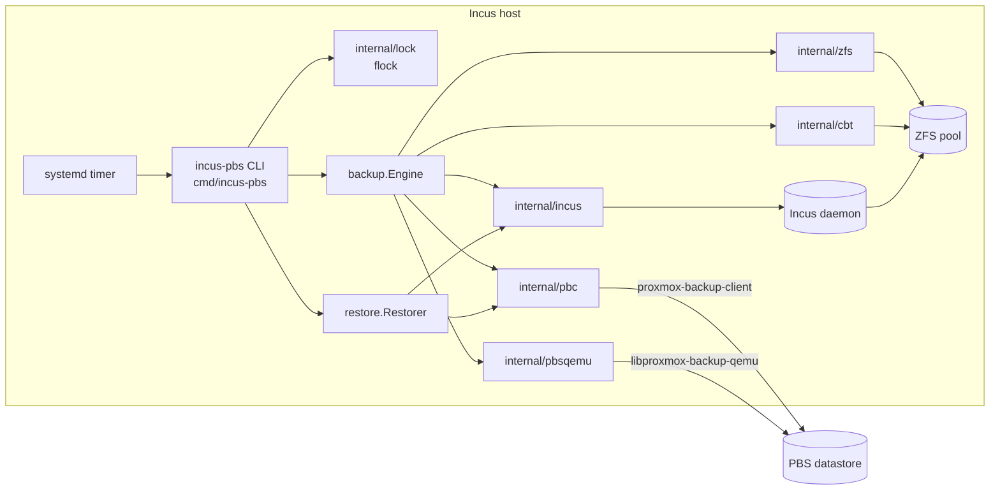
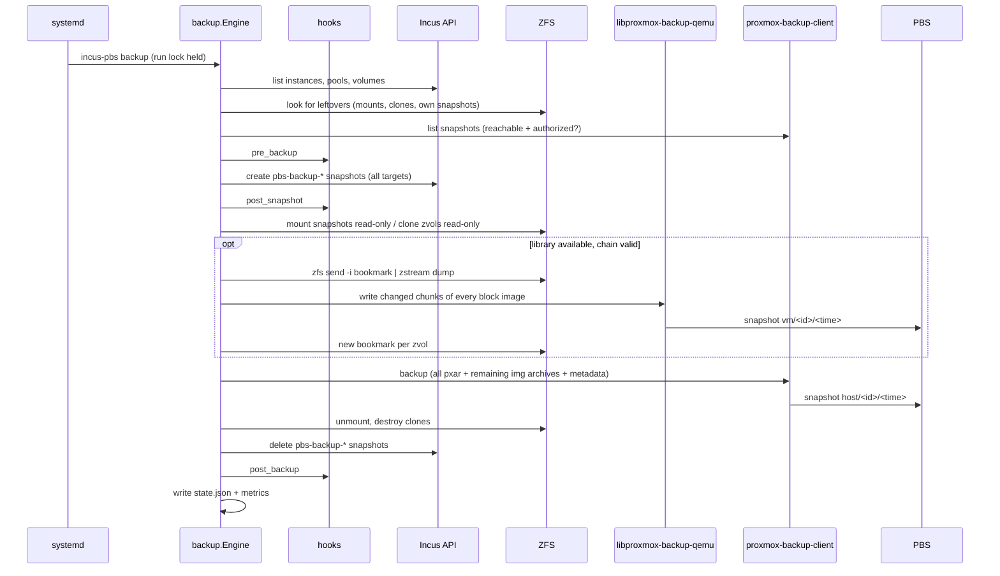
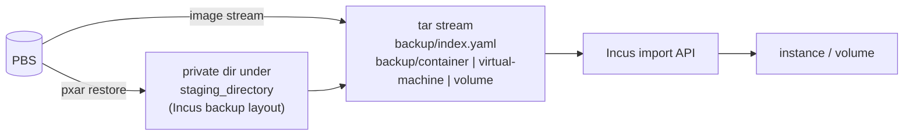

# Architecture

This document explains how incus-pbs works: the moving parts, what happens during a backup and a restore, what is stored where, and why the design looks the way it does.

## Overview

incus-pbs is glue between three existing, well-tested systems. It has no backup protocol, chunking, deduplication, encryption or scheduling of its own.

| System | Used for | Accessed through |
|---|---|---|
| **Incus** | Discovery of instances, volumes and pools; consistent point-in-time snapshots; restore via the import API | The official Go client on the local unix socket (`internal/incus`) |
| **ZFS** | Zero-copy, read-only exposure of those snapshots; change tracking for block devices | `zfs`, `mount`, `zstream` via argv-only exec (`internal/zfs`, `internal/execx`) |
| **Proxmox Backup Server** | Chunking, deduplication, compression, client-side encryption, transfer, retention | The official `proxmox-backup-client` (`internal/pbc`) and, for incremental block images, the official `libproxmox-backup-qemu` loaded with dlopen (`internal/pbsqemu`) |



Everything runs as one short-lived process per command. There is no daemon. Scheduling is a systemd timer that ticks every 5 minutes and runs `backup --scheduled`, which backs up only what is due (see [Schedules](#schedules)). The only persistent state is a few small files under `storage.state_directory`.

## Design decisions

These choices shape the whole tool. Each one was validated against a real Incus 7.6 / ZFS 2.3 / PBS 4 setup.

1. **No export files.** Incus can export instances as tarballs, but that copies every byte to local disk first. incus-pbs instead takes an Incus snapshot and exposes the ZFS snapshot directly: filesystem datasets are mounted read-only, zvols are cloned read-only (a clone costs a few KiB). The client reads straight from there, so the staging area needs only kilobytes and disk space stops being a sizing concern.

2. **Stable archive names.** PBS deduplicates against the archive *of the same name* in the previous snapshot of the group. Archive names are derived only from kind, project, pool and name (`ct_default_web.pxar`, never anything run-specific), and mount points are stable too. That is what lets pxar `--change-detection-mode metadata` skip unchanged files (an unchanged container takes ~2 s) and lets image archives reuse chunks.

3. **Self-contained guest snapshots.** Each guest group is written by one client call (or one library session) and carries its own manifest (`incus-guest.conf`). PBS only finalizes a snapshot when it completes successfully, so "a failed export is never a successful backup" holds by construction, and a finished guest snapshot is restorable on its own. Instances can have their own schedules, so a run often covers a few instances only. The run index (`host/<backup_id>`) holds the host-wide part: Incus metadata, host config, shared and standalone volumes. It is written last, only when that part is due.

4. **Temporary snapshots with a recognizable name and an expiry.** Every snapshot incus-pbs creates is called `pbs-backup-YYYYMMDD-HHMMSS` and carries an Incus expiry (`backup.snapshot_expiry`, 24 h by default). Only names matching that pattern are ever deleted, and Incus removes forgotten ones on its own even if incus-pbs never runs again.

5. **Change tracking for VM disks.** Incus does not expose QEMU dirty bitmaps, so without help the client must read and hash the whole zvol every run (~65 s for an unchanged 8 GiB disk on modest hardware). ZFS already knows what changed: a bookmark plus `zfs send -i` yields the changed ranges, and `libproxmox-backup-qemu`, the library QEMU itself uses for incremental backups, writes only those chunks. See [block-incremental.md](block-incremental.md).

6. **Restore through Incus, not around it.** A restored VM's zvol is created by Incus with `volmode=none`, and writing into Incus-managed datasets directly would bypass its database. Restore therefore rebuilds the exact layout of an Incus backup tarball and hands it to the official import API. Incus recreates config, devices and profiles itself, onto any storage driver.

7. **Crash-consistent by default, application-consistent with hooks.** Container snapshots are atomic ZFS snapshots; VM snapshots do not freeze the guest filesystem (a restored VM replays its journal on first boot). `pre_backup` / `post_snapshot` hooks bracket only the snapshot step, so a freeze or DB flush lasts seconds, not the length of the upload. See [hooks.md](hooks.md).

## A backup run

```
systemd timer ─► incus-pbs backup --scheduled
  1. lock            flock on backup.lock_file (exit 75 if held; 0 with --scheduled)
  2. discover        Incus API: instances, pools, custom volumes, devices → plan
                     --scheduled: keep only due targets (state.json), exit 0 if none
  3. preflight       staging dir 0700; leftovers of a crashed run (own snapshots,
                     clones, mounts) are removed (auto_cleanup); PBS reachable + authorized
  4. snapshot        pre_backup hooks → Incus API snapshot "pbs-backup-YYYYMMDD-HHMMSS"
                     (with expiry) for every instance and custom volume, back-to-back
                     → post_snapshot hooks (always run once pre_backup started)
  5. expose          container / fs volume → mount -t zfs -o ro <ds>@snapshot-<snap>
                     VM disk / block volume → zfs clone -o readonly=on → /dev/zvol/…
  6. guest groups    one PBS snapshot per instance, with its volumes and its
                     incus-guest.conf manifest:
                     ct/<id>/<time> via proxmox-backup-client,
                     vm/<id>/<time> via changed-block tracking (client as fallback)
  7. run index       (when backup.schedule is due, on manual runs, or when a
                     shared/standalone volume is part of the run)
                     manifest.json + Incus API dump → incus-metadata.pxar,
                     allowlisted host files + pool layout → host-config.pxar,
                     shared/standalone volumes → host/<backup_id>/<time>,
                     whose manifest maps every archive to its snapshot
  8. cleanup         reverse order: unmount, destroy clones, delete snapshots
                     (also on failure, SIGTERM or timeout)
  9. record          post_backup hooks; state.json, Prometheus textfile
```



The code lives in `internal/backup`. `Engine.Run` (`engine.go`) is the whole sequence above in one function; the steps below describe its mechanics.

### Discovery and the plan

`Discover` (`plan.go`) turns the Incus inventory into a `Plan`: a list of `Target`s (container, VM or custom volume), a list of `Excluded` items with reasons, and warnings. For each target it resolves the storage pool, the archive base name and the schedule, and records a `Problem` if the target cannot be backed up (non-ZFS pool, unsupported volume content type, a name that is not a valid PBS archive name, …). Nothing is touched during discovery. `incus-pbs list` prints exactly this plan, with the next scheduled run of each target.

### Schedules

Each target has a cron expression:

- **Instances:** `user.incus-pbs.schedule` if set and valid, otherwise `backup.schedule`.
- **Volumes used by exactly one instance:** the owner's schedule. They are stored in its group.
- **Everything else** (shared and standalone volumes, the run index): `backup.schedule`.

`SelectDue` (`schedule.go`) keeps a target when its schedule has a slot between its last attempt (`state.json`) and now. Missed slots therefore fire once, failures wait for the next slot, and a target without history is due at once.

The run index is due when `backup.schedule` is due, or as soon as a shared or standalone volume has no history yet. A tick with nothing due exits without touching the state. Hooks bound to an instance only run when that instance is part of the run.

Custom volumes attached to selected instances are included automatically (or explicitly listed as excluded when `include_custom_volumes: false`); a volume is never silently missing.

### Error policy

`backup.on_instance_error` decides what one broken target means:

- `abort` (default): any target that cannot be planned, snapshotted or exposed fails the run before upload. No PBS snapshot is created; exit code 1.
- `skip`: the other targets are backed up. The manifest records `complete: false` and the failed items; exit code 2.

### Parallelism

Snapshot creation and exposure run through `Engine.forEach`, an `errgroup` bounded by `backup.parallelism`. Snapshots are taken back-to-back so all targets share nearly the same point in time. The upload itself is one client process; the client parallelizes internally.

### Cleanup stack

Every step that creates something pushes its undo onto a `cleanupStack` (snapshot → delete snapshot, clone → destroy clone, mount → unmount, metadata dir → remove). A deferred function runs the stack in LIFO order with its own 10-minute timeout, independent of the run context. It runs on success, failure, timeout and SIGTERM alike. The order matters: a ZFS clone pins its origin snapshot, so the clone must be destroyed before the Incus snapshot can be deleted. LIFO gives that for free.

Cleanup failures do not hide a successful upload, but they turn exit 0 into exit 2 and are logged with a hint to run `incus-pbs cleanup`.

### Signals and timeouts

`cmd/incus-pbs` wraps the run in `signal.NotifyContext(SIGINT, SIGTERM)`. Cancellation propagates to every child process: the client receives SIGINT first (and SIGKILL 30 s later), so PBS never finalizes a half-written snapshot. `pbs.timeout` adds an upper bound for the upload only. The systemd unit uses `KillMode=mixed` and `TimeoutStopSec=15min` so cleanup has time to finish.

### Crash recovery

After a SIGKILL or power loss nothing gets to run the cleanup stack. Three mechanisms cover it:

- Mounts live in the service's private mount namespace and disappear with it.
- Temporary snapshots carry an Incus expiry.
- The next run holds the lock, so any `pbs-backup-*` snapshot, staging clone or staging mount it finds must belong to a dead run. With `backup.auto_cleanup: true` (default) it removes them in safe order (mounts, clones, snapshots) and records them as `crash_recovery` in the report. With `false` it refuses to start. `incus-pbs cleanup [--dry-run]` does the same on demand (`cleanup.go`).

## ZFS layout and exposure

incus-pbs only reads Incus-managed datasets. It derives their names the same way Incus does (`incus.Datasets`, `incus.VolumeDatasets`):

| Target | Dataset(s) | Exposed as | Archive |
|---|---|---|---|
| Container | `<pool>/containers/<name>` | read-only snapshot mount | `ct_<project>_<name>.pxar` |
| VM | `<pool>/virtual-machines/<name>` (config, NVRAM) | read-only snapshot mount | `vm_<project>_<name>-config.pxar` |
| | `<pool>/virtual-machines/<name>.block` (root disk) | read-only clone → `/dev/zvol/…` | `vm_<project>_<name>.img` |
| Custom volume, filesystem | `<pool>/custom/<project>_<name>` | read-only snapshot mount | `vol_<project>_<pool>_<name>.pxar` |
| Custom volume, block | `<pool>/custom/<project>_<name>` (a zvol) | read-only clone | `vol_<project>_<pool>_<name>.img` |

Instances in a non-default project are stored as `<project>_<name>`; custom volumes always carry the project prefix, including `default_`. An Incus snapshot `S` is the ZFS snapshot `@snapshot-S`.

Everything incus-pbs creates lives in two places:

- **Clones:** children of `<pool>/<storage.staging_dataset_name>` (default `incus-pbs-staging`). The parent is created unmounted by `check` or the first run.
- **Mounts:** below `<storage.staging_directory>/mnt/<archive base>`.

`internal/zfs` enforces this. `Destroy` refuses any dataset that is not a strict child of the staging dataset; `Unmount` refuses any path outside the mount root; destroys are never recursive. Incus-managed datasets are only ever used as a mount source or clone origin.

## PBS data model

Each instance gets its own PBS backup group in `pbs.namespace`, as under Proxmox VE:

| Group | Contents |
|---|---|
| `ct/<id>` | `ct_<project>_<name>.pxar`, plus volumes attached only to this container, plus `incus-guest.conf.blob` |
| `vm/<id>` | `vm_<project>_<name>.img` (incremental via libproxmox-backup-qemu), `vm_<project>_<name>-config.tar.blob`, plus volumes attached only to this VM, plus `incus-guest.conf.blob`. One snapshot per run that includes the VM. If the library is unavailable or fails, or the VM has filesystem volumes attached, the client writes `.img` + `-config.pxar` instead. |
| `host/<backup_id>` | The run index: `incus-metadata.pxar` (manifest, Incus API dump), `host-config.pxar`, shared or standalone volumes. Written when `backup.schedule` is due (and on manual runs). |

- `<id>` is the instance name, with a `<project>_` prefix outside the `default` project. Incus allows `_` in neither project nor instance names, so two instances can never share a group. Versions before 0.2 used `<project>-<name>`, which could collide (project `a` + `b-c` vs project `a-b` + `c`). Restores still read those old groups, but new backups of non-default-project instances start a new group (one full upload).
- Guest groups don't include the host's `backup_id`. Give every host its own PBS namespace. Restores skip guest snapshots written by another host, but sharing groups between hosts breaks incremental chains and mixes retention.
- Guest groups are uploaded first and the index last, so the index only references snapshots that exist.
- Each guest snapshot carries its own manifest. Restore resolves instances through their own group and never needs the index for them.
- If one guest group fails to upload, the others are kept, and the run is partial (exit 2, `complete: false`). If the index upload fails, the run fails, but the guest snapshots of that run are complete and restorable on their own.
- One run is a set of snapshots, not a single atomic PBS snapshot. Within a run the data stays consistent, because all Incus snapshots are taken back to back before any upload. Instances on different schedules are backed up at different times by design.
- The gain: per-guest retention, protection, notes and browsing in the PBS UI.
- Standalone or shared block volumes go into the index snapshot through the client, without change tracking (the library only writes `vm` groups).

| Archive | Content |
|---|---|
| `ct_<project>_<name>.pxar` | Container dataset snapshot: `rootfs/`, `backup.yaml`, `metadata.yaml`, `templates/`, `credentials/` |
| `vm_<project>_<name>.img` | VM root disk, fixed 4 MiB chunks |
| `vm_<project>_<name>-config.pxar` / `-config.tar.blob` | VM config dataset (`backup.yaml`, NVRAM, …); a tar blob when the VM is written through the library |
| `vol_<project>_<pool>_<name>.pxar` / `.img` | Custom volume (filesystem / block) |
| `incus-guest.conf.blob` | Guest manifest (JSON): host and run, the targets in this snapshot with their schedule, the instance's API object and its profiles (secret-like keys redacted) |
| `incus-metadata.pxar` | `manifest.json`, `incus-project-<p>.json` (instances, profiles, networks, pools, volumes; secret-like keys redacted) |
| `host-config.pxar` | Allowlisted host files, `zpool list -v`, `zfs list`, `uname -a` |

### The manifest

`manifest.json` (`metadata.go`) is the index of a backup and the first thing every restore reads. It records:

- `complete`: false when targets were skipped under `on_instance_error: skip`
- `items`: per target, its status, archives, source datasets and errors
- `targets`: the full plan (kind, project, name, pool, content type, archive base)
- `excluded`, `warnings`
- `archive_snapshots`: which snapshot (`ct/…`, `vm/…`, or the host index) holds each archive; each item also carries its `snapshot`
- tool, Incus and client versions, PBS settings, selection, hostname

`manifest_version` is 3, and restore refuses other versions. Guest manifests (`incus-guest.conf`) have their own `guest_manifest_version` (1).

## Block images and change tracking

In short (details in [block-incremental.md](block-incremental.md)):

1. `backupBlocks` (`block.go`) loads the library. If it is missing, every image goes through the client instead.
2. Per image it decides incremental or full: bookmark present and GUID unchanged, same size, library chain check passes, `block_full_interval` not exceeded, and (in `auto` mode) no foreign snapshots on the zvol.
3. For incremental images, `zfs send -i <bookmark> <snapshot> | zstream dump -v` is parsed by `internal/cbt` into a set of dirty and all-zero 4 MiB chunks.
4. One library session writes all images. Unchanged chunks are taken from the previous snapshot's index; only dirty chunks are read from the read-only clone.
5. After the vm/ snapshot is finalized, a new bookmark `<zvol>#incus-pbs-<run>` is created per image and `block-state.json` is saved.

Any library error before the session finishes aborts the session and sends those images through the client in the same run. Uncertainty always means a full read.

## Restore

Restore (`internal/restore`) is the backup path in reverse, built around Incus' own import:



1. **Locate** the target:
   - **Instances:** the newest snapshot of the instance's own group (at or before a given time, or exactly a given `ct|vm/<id>/<time>`), read through its `incus-guest.conf`.
   - **Volumes:** additionally the newest run index, whichever is newer.
2. **Check before downloading:**
   - The target must not exist, and the pool must exist.
   - Profiles, networks and volumes the instance needs must exist in the target project (from the guest manifest).
   - Free space in the staging directory is checked.
3. **Restore the pxar archives** into a private directory, laid out exactly like an Incus backup tarball. `backup.yaml` is rewritten for the target: name, project, pool, snapshots removed, and identity (MACs, UUIDs, cloud-init instance-id) kept or regenerated according to `--identity`. Dependencies are checked again against this authoritative copy.
4. **Stream into Incus.** The directory is tarred on the fly. Disk images are not staged: they are streamed from PBS into the tar stream, so the download overlaps the import.

The **host recovery kit** (`restore host`) changes nothing on the host. It restores `incus-metadata.pxar` and `host-config.pxar` into a directory and writes a suggested `preseed.yaml` (pools, networks, profiles, projects) and an ordered `RECOVERY.md` with the restore commands for every target: the run index's volumes plus the newest guest snapshot of every instance of this host. The old Incus database is never copied.

**Instant access** (`restore mount`) skips the import entirely: pxar archives are FUSE-mounted with `proxmox-backup-client mount`, image archives are mapped to a loop device with `proxmox-backup-client map` (data fetched on demand) and a partition is mounted read-only.

All restore commands take the run lock. See [restore.md](restore.md) for usage and safety rules.

## State on disk

| Path | Written by | Purpose | If deleted |
|---|---|---|---|
| `backup.lock_file` (`/run/incus-pbs.lock`) | every backup, cleanup and restore | `flock` so runs never overlap; released by the kernel when the process dies | recreated |
| `<state_directory>/state.json` | each backup run that did something | last run report, last success, per-target history (last attempt, schedule, next slot), the run index's last attempt; read by `status`, `list`, the metrics and `backup --scheduled` | `status` reports no history; the next scheduled tick backs up everything once |
| `<state_directory>/block-state.json` | runs with change tracking | library chain state, last vm/ snapshot, per-image bookmark name, GUID, size, last full read | next run reads every block device in full; stale bookmarks are harmless |
| `monitoring.textfile_path` | each backup run | Prometheus metrics for node_exporter's textfile collector | rewritten on the next run |
| `<staging_directory>/mnt/…`, `…/metadata`, restore dirs | during a run | mount points and generated metadata; empty between runs | recreated |
| `<pool>/incus-pbs-staging` | `check` / first run | parent of temporary clones; empty between runs | recreated |
| `<zvol>#incus-pbs-<run>` bookmarks | change tracking | base for the next incremental diff; cost no space | next run of that disk is a full read |

State files are written atomically (temp file + rename) with mode 0600; the metrics textfile is written atomically with mode 0644 so node_exporter can read it.

## Safety properties

| Property | How it is enforced |
|---|---|
| A failed export is never a successful backup | Everything is uploaded by one client invocation. PBS only finalizes the snapshot if the client exits 0. With `on_instance_error: abort` (the default), any target failure stops the run before upload. With `skip`, the manifest says `complete: false` and the run exits 2. |
| User snapshots are never touched | Only names matching `^pbs-backup-\d{8}-\d{6}$` can be created or deleted; the provider refuses everything else. |
| No uncontrolled deletion | `zfs destroy` (non-recursive) and `umount` only run on children of `<pool>/incus-pbs-staging` and `<staging_directory>/mnt`. Path and dataset guards reject anything else. |
| Crash recovery | After SIGKILL or a power loss: mounts die with the service's private mount namespace, temporary snapshots carry an Incus expiry, and the next run removes leftover clones and snapshots under the run lock before it starts (`auto_cleanup`). It was verified with `systemctl kill -s KILL` mid-upload. `incus-pbs cleanup [--dry-run]` does the same on demand. |
| Application consistency | `pre_backup` / `post_snapshot` hooks bracket only the snapshot step, so the freeze window is short. Thaw hooks always run. |
| Restore never overwrites | Existing instances/volumes, missing profiles, volumes or networks stop a restore before import. |
| No concurrent runs | `flock` on `backup.lock_file`; the kernel releases it if the process dies. |
| Graceful stop | SIGTERM cancels the context, the client gets SIGINT (SIGKILL after 30 s), and cleanup runs with its own timeout. |
| No shell, no secrets on argv | `os/exec` with argument slices. The repository and the *path* of the token file go via `PBS_REPOSITORY` and `PBS_PASSWORD_FILE`. Secret files must not be group/world accessible. |
| Custom volumes never silently omitted | Attached volumes are backed up, or explicitly listed as excluded (in the log and the manifest) when `include_custom_volumes: false`. Host-path disks produce a warning. |
| Bookmarks are scoped | Only bookmarks named `<dataset>#incus-pbs-*` are created or destroyed; `cleanup --release-bookmarks` removes exactly those. |
| Incremental never guesses | Any doubt about the change-tracking chain (bookmark, size, library state, stream completeness, age) means a full read of that disk. |

## Packages

| Package | Role |
|---|---|
| `cmd/incus-pbs` | CLI: flag parsing, config loading, signal handling and lock (`main.go`), backup/check/list/status/cleanup (`commands.go`), restore subcommands (`restore.go`) |
| `internal/config` | Strict YAML (unknown keys rejected), defaults, validation that collects all problems |
| `internal/incus` | Incus provider (instances, pools, volumes, snapshots, metadata, import), dataset naming |
| `internal/zfs` | Snapshot mounts, clones, bookmarks, guards |
| `internal/pbc` | Client invocation, argument building, output and stats parsing |
| `internal/execx` | Safe process execution (argv only, context-aware, SIGINT then SIGKILL) |
| `internal/backup` | Discovery plan, engine, hooks, metadata/manifest, change tracking, check, cleanup, state and metrics |
| `internal/restore` | Snapshot resolution, manifest, instance/volume restore via Incus import (images streamed), instant mounts, host recovery kit |
| `internal/cbt` | Changed-block set from `zstream dump` (WRITE/FREE records → dirty / zero chunks) |
| `internal/pbsqemu` | dlopen bindings for libproxmox-backup-qemu (no cgo; a stub on non-Linux) |
| `internal/lock` | Run lock |

External systems are behind interfaces (`incus.Provider`, `execx.Runner`, `backup.BlockBackend`, `backup.DiffFunc`), so the unit tests run the full engine and restore logic against fakes, without Incus, ZFS or PBS.

## Performance notes

| Measurement on the reference host (4 vCPU, 1 GbE) | Result |
|---|---|
| Unchanged run, 2 containers + 1 VM (8 GiB) + 4 volumes | **7.8 s** with [change tracking](block-incremental.md) (82 s without) |
| 200 MiB written in the VM | 13 s (VM disk 3.5 s, 66 of 2048 chunks read) |
| Unchanged container with pxar metadata change detection | ~2 s; time grows with churn, not with size |
| Restore, container (1.4 GiB) | ~75 s |
| Restore, VM (8 GiB) | ~216 s: streamed from PBS, the rest is Incus' import |
| Instant access (`restore mount`), container or VM | < 1 s |

The client's hashing and compression are CPU-bound (~300 / ~260 MB/s on an i5-6500T), which is why change tracking matters more than bandwidth.

Tuning:
- `pbs.exclude_patterns` for caches and temporary data
- `pbs.rate_limit` to protect the uplink
- the systemd unit's `Nice=` / `IOSchedulingClass=`

## Known limitations

- **Change tracking for VM disks needs `libproxmox-backup-qemu0`** (from the Proxmox VE repository). In the default `auto` mode it is disabled for zvols that carry other snapshots, so `incus snapshot restore` keeps working; see [block-incremental.md](block-incremental.md).
- **VM snapshots are crash-consistent unless hooks are configured.**
- **Only ZFS-backed instances and volumes can be backed up.** Restore works onto any driver.
- **Instance snapshots are not part of backups.**
- **Cross-project attached volumes** are reported as a problem.
- **A full VM restore is bounded by Incus' import,** which spools the upload; use `restore mount` for file-level recovery.
